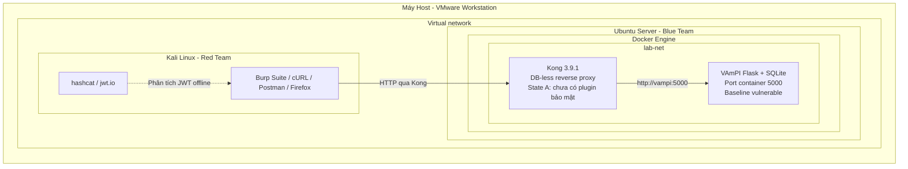
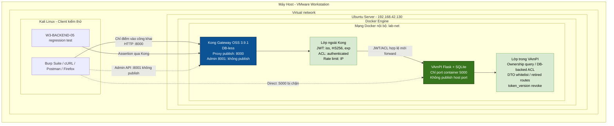

# SƠ ĐỒ KIẾN TRÚC HỆ THỐNG LAB

> **Học phần:** Chuyên đề Hệ thống mạng và Bảo mật (010412304602)  
> **Sinh viên:** Huỳnh Thị Quý Trân — MSSV: 051305000763  
> **GVHD:** Thầy Bùi Dương Thế  
> **Phạm vi:** So sánh State A (baseline) và State B (hardened)

## 1. Nguyên tắc so sánh

Topology nền được giữ nhất quán giữa hai trạng thái: Kali là máy kiểm thử bên
ngoài; Ubuntu chạy Kong và VAmPI trong Docker; Kong gọi VAmPI qua `lab-net`.
State B không thêm proxy hoặc backend mới, mà tăng cường kiểm soát ở hai lớp:
Kong ở ranh giới mạng và VAmPI ở ranh giới nghiệp vụ/dữ liệu. Vì vậy re-test
Tuần 4 đo hiệu quả của control thay vì hiệu ứng do đổi kiến trúc.

## 2. State A — Baseline

State A là mốc dùng để thực hiện PoC BOLA, JWT và excessive data exposure.
Kong chỉ thực hiện reverse proxy; logic ownership, lọc field phản hồi và thu
hồi token chưa được áp dụng đầy đủ tại backend.

## 3. State B — Kiến trúc phòng thủ hai lớp

### 3.1 Luồng request hợp lệ

1. Client trên Kali gửi request đến duy nhất `Ubuntu:8000`.
2. Kong kiểm tra JWT, group ACL và quota rate limiting. Login/register là route
   public nhưng vẫn có rate limit theo IP.
3. Với route protected, Kong chỉ forward request hợp lệ đến `http://vampi:5000`
   trong `lab-net`.
4. VAmPI lấy subject từ JWT đã xác minh, tra user ở database và áp dụng policy
   ownership/RBAC theo Access Control Matrix.
5. VAmPI trả DTO whitelist; token có `token_version` cũ bị từ chối sau đổi mật
   khẩu, kể cả khi chữ ký JWT vẫn hợp lệ.

### 3.2 Luồng request bị từ chối

| Điểm từ chối | Ví dụ | Kết quả kỳ vọng | Bằng chứng |
| --- | --- | --- | --- |
| Kong | Thiếu JWT, chữ ký sai hoặc token hết hạn | `401`; request không đến VAmPI | W3-KONG-03 |
| Kong | Vượt quota login/protected route | `429` kèm rate-limit headers | W3-KONG-05 |
| VAmPI | Attacker gọi book của victim | `404` không lộ object | W3-BACKEND-01/05 |
| VAmPI | User thường gọi directory/profile không thuộc quyền | `403` | W3-BACKEND-02/05 |
| VAmPI | Token phát hành trước đổi mật khẩu | `401` do `token_version` không khớp | W3-BACKEND-04/05 |

## 4. Thay đổi từ State A sang State B

| Hạng mục | State A | State B | Mục đích bảo mật |
| --- | --- | --- | --- |
| Điểm vào host | VAmPI từng có thể publish `:5000` | Chỉ Kong proxy `:8000` publish; `:8001` không publish | Ép traffic qua gateway |
| Kong | Reverse proxy trần | JWT, ACL, rate-limiting | Xác thực, coarse-grained access control, giảm brute force/quét dò |
| Ownership | Không ràng buộc đầy đủ chủ sở hữu | `book_title` và `user_id` cùng truy vấn | Chặn BOLA tại backend |
| Response | Có nguy cơ serialization field nội bộ/debug | DTO whitelist; gỡ `/_debug` và `/createdb` | Giảm excessive data exposure và bề mặt tấn công |
| JWT lifecycle | Token cũ có thể còn dùng đến `exp` | `token_version` trong DB và claim JWT | Thu hồi token sau đổi mật khẩu |

## 5. Phân định trách nhiệm State B

| Thành phần | Địa chỉ/cổng | Trách nhiệm |
| --- | --- | --- |
| Kali | Máy client kiểm thử | Chỉ gửi request qua Kong; chạy PoC và regression test trong phạm vi lab. |
| Kong Gateway | Host `:8000`; nội bộ `:8000`, `:8001` | Xác thực JWT, ACL group `authenticated`, rate limiting theo IP, proxy đến backend. Không quyết định ownership hoặc quyền admin từng user. |
| VAmPI | Chỉ nội bộ `lab-net:5000` | Quyết định ownership, quyền dựa trên DB, DTO response, retired routes và token lifecycle. |
| SQLite | Bind mount private của VAmPI | Lưu user, book và `token_version`; không expose qua HTTP/host port. |
| `lab-net` | Docker bridge nội bộ | Kết nối riêng Kong ↔ VAmPI; phân giải service `vampi`. |

## 6. Xác nhận runtime

`scripts/w3_wrap_01_state_b_verify.sh` đã PASS 18 assertion trên Ubuntu ngày
2026-11-18: VAmPI/Kong cùng `lab-net`, VAmPI không có host port, chỉ Kong
`:8000` được publish, ba plugin active và tất cả marker backend State B có
mặt trong container đang chạy. Regression W3-BACKEND-05 chạy từ Kali cũng PASS
18 assertion, xác nhận chức năng hợp lệ không bị hỏng.

Evidence runtime nằm tại `.state-b/evidence/` trên Ubuntu và `evidence/` tại
clone Kali; các thư mục này được Git ignore để không commit log, JWT, database
hoặc ảnh có thể chứa dữ liệu lab.
