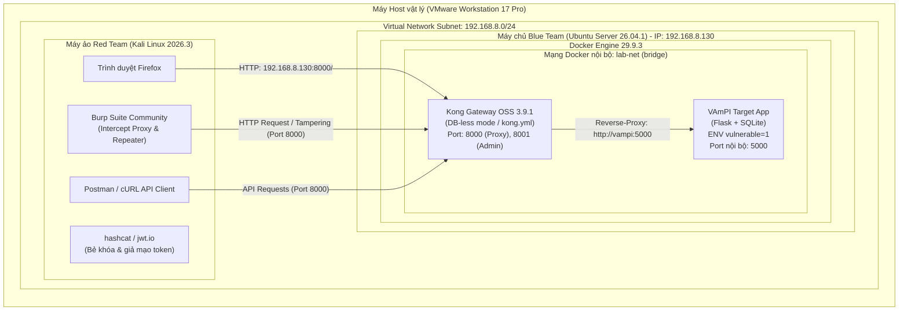

# SƠ ĐỒ KIẾN TRÚC HỆ THỐNG LAB (W1-DOC-01)

> **Học phần:** Chuyên đề Hệ thống mạng và Bảo mật (010412304602)  
> **Sinh viên:** Huỳnh Thị Quý Trân — MSSV: 051305000763  
> **GVHD:** Thầy Bùi Dương Thế  
> **Giai đoạn:** State A — Baseline (Hệ thống chưa vá / Kong Reverse-Proxy trần)

---

## 1. Sơ đồ luồng dữ liệu và phân vùng mạng

---

## 2. Bảng phân định trách nhiệm các thành phần

| Thành phần | Địa chỉ & Cổng | Vai trò kỹ thuật trong đề tài |
|---|---|---|
| **Máy Red Team (Kali Linux)** | `192.168.8.x` | Môi trường kiểm thử an ninh: Chạy Burp Suite để đánh cắp/sửa Object ID (BOLA); chạy `hashcat` brute-force khóa bí mật JWT; phân tích response JSON để phát hiện rò rỉ dữ liệu. |
| **Máy Blue Team (Ubuntu Server)** | `192.168.8.130` | Máy chủ dịch vụ lưu trữ: Cung cấp môi trường Docker điều phối cổng Gateway và Backend. |
| **Kong API Gateway** | `192.168.8.130:8000` `192.168.8.130:8001` | Điểm tiếp nhận lưu lượng tập trung duy nhất từ bên ngoài. Phiên bản `kong:3.9.1` DB-less. Ở State A: Đóng vai trò Reverse-Proxy trần. Ở State B: Kích hoạt JWT, ACL, Rate Limiting. |
| **VAmPI Backend** | Cổng container: `5000` (mạng `lab-net`) | Ứng dụng mục tiêu mô phỏng OWASP API Security Top 10 (Python Flask + SQLite). Đang chạy chế độ `vulnerable=1` với `SECRET_KEY = 'random'`. |
| **Mạng Docker `lab-net`** | Bridge driver nội bộ | Cô lập kết nối giữa Gateway và Backend; cho phép Kong phân giải DNS và gọi đến VAmPI bằng tên container `http://vampi:5000`. |

